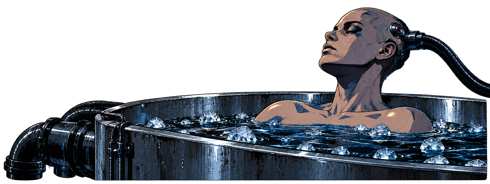

<div align="center">



<picture>
  <source media="(prefers-color-scheme: dark)" srcset="./assets/ICE_BATH_BANNER_TEXT_WHITE.png" />
  <source media="(prefers-color-scheme: light)" srcset="./assets/ICE_BATH_BANNER_TEXT_BLACK.png" />
  
</picture>

<samp>A tiling agentic harness and netrunner toolkit for a deep dive beyond the blackwall.</samp>

</div>

## Install

```sh
curl -fsSL icebath.app | sh
irm icebath.app | iex
brew install nickheyer/tap/icebath
yay -S icebath-bin
winget install nickheyer.icebath
scoop bucket add nickheyer https://github.com/nickheyer/scoop-bucket && scoop install nickheyer/icebath
choco install icebath
nix profile add github:nickheyer/nixpkg#icebath
mise use -g github:nickheyer/icebath
docker run -it --rm -e ICEBATH_UID=$(id -u) -e ICEBATH_GID=$(id -g) -v ~/.icebath:/opt/data ghcr.io/nickheyer/icebath
go install -tags goolm github.com/nickheyer/icebath/cmd/icebath@latest
git clone https://github.com/nickheyer/icebath && icebath/setup-icebath.sh
# apt, dnf and apk https://icebath.app
```

## Usage

```sh
icebath                         # open the TUI, set up a model there on first run
icebath chat -q "check disk usage"
icebath gateway install         # messaging gateway as a background service
icebath update
icebath uninstall
```
